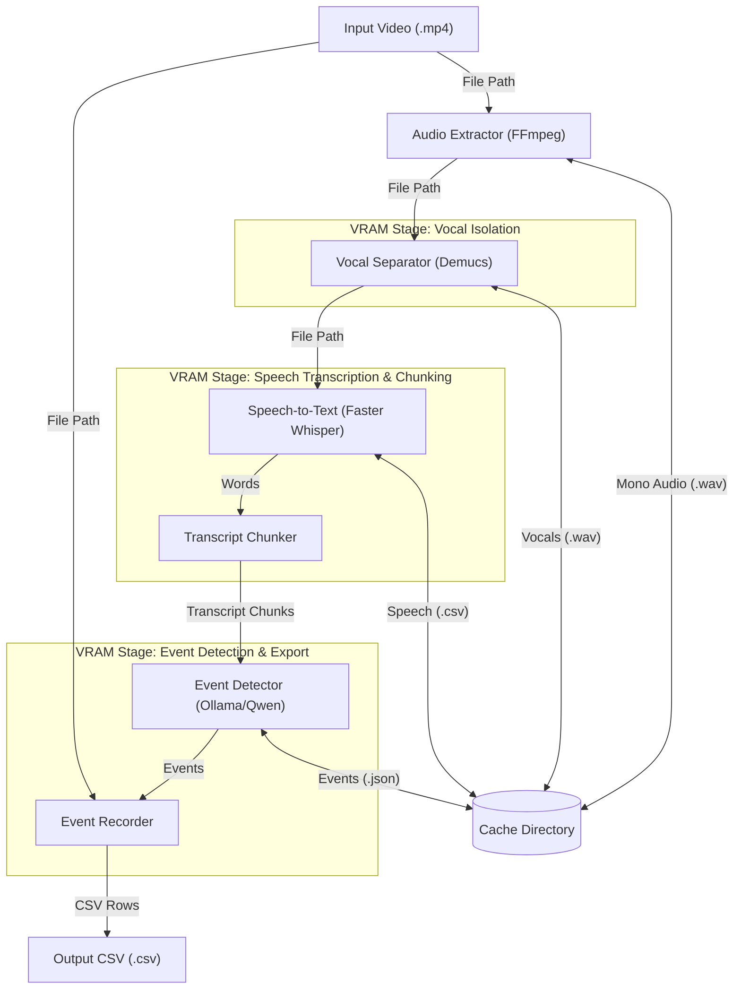

# Ballroom Scribe

This AI pipeline generates timestamps in videos of ballroom competitions. It takes the videos as inputs and outputs a
CSV file of the starting timestamp of individual events, along with other details like the proficiency levels and types
of dance.

## Architecture

The process is orchestrated by [timestamp_pipeline.py](ballroom_scribe/timestamp_pipeline.py) in distinct stages.



1.  **Audio Extraction** ([extract_audio.py](ballroom_scribe/utils/extract_audio.py)): Extracts the audio from the video
    file using [FFmpeg](https://ffmpeg.org/).
2.  **Vocal Isolation** ([vocal_isolator.py](ballroom_scribe/vocal_isolator.py)): Isolates vocals from music using
    [Demucs](https://github.com/adefossez/demucs).
    *   VRAM is freed upon completion.
3.  **Speech Transcription** ([speech_transcriber.py](ballroom_scribe/speech_transcriber.py)): Transcribes the vocals to
    timestamped words using [Faster Whisper](https://github.com/SYSTRAN/faster-whisper).
    *   VRAM is not freed until the next stage because this stage is a Python generator and runs at the same time as
        the next stage.
4.  **Transcript Chunking** ([transcript_chunker.py](ballroom_scribe/transcript_chunker.py)): Splits the transcript at
    silences.
    *   VRAM is freed upon completion.
5.  **Event Detection** ([event_detector.py](ballroom_scribe/event_detector.py)): Parses the emcee's announcements for
    each event's proficiency level, dance type, etc. using **Qwen 2.5 7B** via [Ollama](https://ollama.com/). Finds the
    starting timestamps of the emcee's announcements.
    *   Ollama handles freeing VRAM.
6.  **Event Recording** ([event_recorder.py](ballroom_scribe/event_recorder.py)): Writes event details to a CSV file.

Each stage that writes to the cache directory skips its work if its output file already exists, so rerunning an
interrupted run resumes where it left off. To make this safe, cache files are written atomically
([atomic_path.py](ballroom_scribe/utils/atomic_path.py)): each file is first written under a temporary name (e.g.,
`Audio.partial.wav`) and renamed to its final name only once it is complete.

## Requirements

Although more hardware may be supported in the future, Scribe currently requires an NVIDIA GPU with CUDA support and a
minimum of **8 GB of VRAM**. These models are used:

*   **Demucs (`htdemucs`)** uses ~2–3 GB of VRAM during vocal separation.
*   **Faster Whisper (`large-v3`)** requires ~3–4 GB of VRAM.
*   **Qwen 2.5 7B (`qwen2.5:7b-instruct-q6_K`)** requires ~6-7 GB of VRAM.
    *   You can use a different model via the `--ollama-model` flag.

## Setup

Follow these steps to set up and run Scribe on your machine:

### Install CUDA Toolkit

The NVIDIA CUDA Toolkit is required to use GPU acceleration in Demucs. Download
it from [NVIDIA](https://developer.nvidia.com/cuda-downloads) for your system
and install it.

### Install System Dependencies

Install Python, FFmpeg (for extracting audio from video), and Ollama (for running the local LLM). On Windows, you can
install all three using `winget`:

```powershell
# Run as Administrator.
winget install -e --id Gyan.FFmpeg
winget install -e --id Python.Python.3.14
winget install -e --id Ollama.Ollama
```

After installation completes, restart your terminal so the new command line tools are added to your system `PATH`.

### Download the Language Model (Ollama)

Download the model:

```powershell
ollama pull qwen2.5:7b-instruct-q6_K
```

### Install Python Dependencies

Install the required packages:

```powershell
pip install -r requirements.txt
```

## Usage

Invoke the main script, [find_timestamps.py](find_timestamps.py), from a PowerShell terminal. The basic usage is:

```powershell
python find_timestamps.py C:\path\to\video.mp4 --output-csv 'C:\path\to\output.csv'
```

You can find more options with:

```powershell
python find_timestamps.py --help
```

The first time that you run the script, you may see the following message:

> Warning: You are sending unauthenticated requests to the HF Hub. Please set a HF_TOKEN to enable higher rate limits
> and faster downloads.

This is normal; it appears when a model is downloaded from HuggingFace. After the first time, the models will be cached
on your local system, and you should not see the message again.
