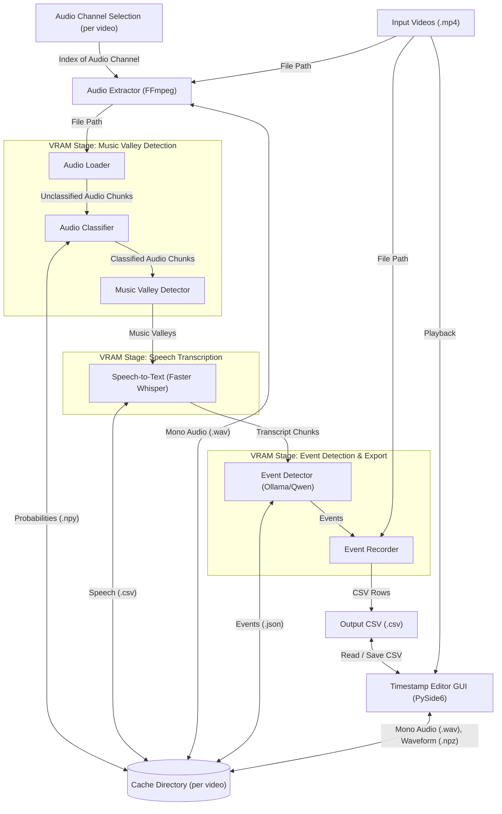

# Ballroom Scribe

This AI pipeline generates timestamps in videos of ballroom competitions. It takes the videos as inputs and outputs a
CSV file of the starting timestamp of individual events, along with other details like the proficiency levels and types
of dance. A desktop GUI ([edit_timestamps.py](edit_timestamps.py)) lets you review the videos alongside their audio
waveforms, run the pipeline, jump to detected events, adjust timestamps and metadata, and save the CSV.

## Architecture

The process is orchestrated by [timestamp_pipeline.py](ballroom_scribe/timestamp_pipeline.py) in distinct stages. When
multiple videos are given, every input is validated up front and then every video passes through each stage before the
next stage begins so that each model is loaded into VRAM only once per run (at the cost of holding the speech audio of
all videos in RAM between the audio classification and speech transcription stages).



1.  **Audio Extraction** ([extract_audio.py](ballroom_scribe/utils/extract_audio.py)): Extracts the audio from the video
    file using [FFmpeg](https://ffmpeg.org/).
2.  **Audio Classification** ([audio_classifier.py](ballroom_scribe/audio_classifier.py),
    [pann_inferencer.py](ballroom_scribe/pann_inferencer.py)): Classifies audio as music and speech using
    [PANNs Inference](https://github.com/qiuqiangkong/panns_inference).
    *   VRAM is freed upon completion.
3.  **Music Valley Detection** ([music_valley_detector.py](ballroom_scribe/music_valley_detector.py)): Finds spans of
    non-music between sustained spans of music.
4.  **Speech Transcription** ([speech_transcriber.py](ballroom_scribe/speech_transcriber.py)): Transcribes the audio
    that was classified as speech into timestamped words using
    [Faster Whisper](https://github.com/SYSTRAN/faster-whisper).
    *   VRAM is freed upon completion.
5.  **Event Detection** ([event_detector.py](ballroom_scribe/event_detector.py)): Parses the emcee's announcements for
    each event's proficiency level, dance type, etc. using **Qwen 2.5 7B** via [Ollama](https://ollama.com/). Finds the
    starting timestamps of the emcee's announcements.
    *   Ollama handles freeing VRAM.
6.  **Event Recording** ([event_recorder.py](ballroom_scribe/event_recorder.py)): Reads and writes event details in CSV
    format with the columns `File`, `Inpoint`, `Inpoint Formatted`, `Level`, `Style`, `Dance`, and `Round`.

Each stage that writes to the cache directory skips its work if its output file already exists, so rerunning an
interrupted run resumes where it left off. To make this safe, cache files are written atomically
([atomic_path.py](ballroom_scribe/utils/atomic_path.py)): each file is first written under a temporary name (e.g.,
`Audio-Channel-0.partial.wav`) and renamed to its final name only once it is complete.

## Requirements

Although more hardware may be supported in the future, Scribe currently requires an NVIDIA GPU with CUDA support and a
minimum of **8 GB of VRAM**. These models are used:

*   **PANNs Inference** uses ~6-8 GB of VRAM when classifying audio.
    *   You can reduce this usage with the `--pann-chunk-minutes` flag.
*   **Faster Whisper (`large-v3`)** requires ~3–4 GB of VRAM.
*   **Qwen 2.5 7B (`qwen2.5:7b-instruct-q6_K`)** requires ~6-7 GB of VRAM.
    *   You can use a different model via the `--ollama-model` flag.

## Setup

Follow these steps to set up and run Scribe on your machine:

### Install System Dependencies

Install Python, FFmpeg (for extracting audio from video), and Ollama (for running the local LLM). On Windows, you can
install all three using `winget`:

```powershell
# Run as Administrator.
winget install -e --id Gyan.FFmpeg
winget install -e --id Python.Python.3.14
winget install -e --id Ollama.Ollama
```

After installation completes, restart your terminal so the new command line tools are added to your system `PATH`.

### Download the Language Model (Ollama)

Download the model:

```powershell
ollama pull qwen2.5:7b-instruct-q6_K
```

### Install Python Dependencies

Install the required packages:

```powershell
pip install -r requirements.txt
```

### Workaround for PANNs Inference

The PANNs Inference library, which is used to discern between dance music and the emcee speaking, will try to download
[a CSV of class labels](https://github.com/qiuqiangkong/panns_inference/blob/f673f604ec6f4805a61c5b3be087e24776ec5fda/panns_inference/config.py#L11-L13)
and
[a PyTorch model checkpoint](https://github.com/qiuqiangkong/panns_inference/blob/f673f604ec6f4805a61c5b3be087e24776ec5fda/panns_inference/inference.py#L34-L37).
Unfortunately, it does it with `wget`, which most Windows machines do not have. You can download it with:

```powershell
$dir = "$HOME\panns_data"
if (-not (Test-Path $dir)) { New-Item -ItemType Directory -Path $dir }
Invoke-WebRequest -Uri "http://storage.googleapis.com/us_audioset/youtube_corpus/v1/csv/class_labels_indices.csv" -OutFile "$dir\class_labels_indices.csv"
Invoke-WebRequest -Uri "https://zenodo.org/record/3987831/files/Cnn14_DecisionLevelMax_mAP%3D0.385.pth?download=1" -OutFile "$dir\Cnn14_DecisionLevelMax.pth"
```

## Usage

Invoke the main script, [find_timestamps.py](find_timestamps.py), from a PowerShell terminal. The basic usage is:

```powershell
python find_timestamps.py -i C:\path\to\video.mp4 {0 or 1} --output-csv 'C:\path\to\output.csv'
```

`{0 or 1}` refers to the audio channel to use. 0 usually means left, and 1 usually means right.

To process multiple videos into a single CSV file, repeat `-i` / `--input` for each video:

```powershell
python find_timestamps.py `
    -i C:\path\to\part1.mp4 1 `
    -i C:\path\to\part2.mp4 1 `
    --output-csv 'C:\path\to\competition.csv'
```

`--output-csv` is optional for a single video (defaulting to the input video's path with a `.csv` extension) and
required when two or more videos are specified. You can pass `-c` / `--cache-dir` immediately after any `-i` / `--input`
to override the parent cache directory for that video; each input video must resolve to its own distinct cache
directory.

You can find more options with:

```powershell
python find_timestamps.py --help
```

The first time that you run the script, you may see the following message:

> Warning: You are sending unauthenticated requests to the HF Hub. Please set a HF_TOKEN to enable higher rate limits
> and faster downloads.

This is normal; it appears when a model is downloaded from HuggingFace. After the first time, the models will be cached
on your local system, and you should not see the message again.

## Reviewing and Editing Timestamps

You can use the [edit_timestamps.py](edit_timestamps.py) desktop GUI to inspect videos alongside their synchronized
audio waveforms, run the timestamp pipeline, jump to detected events, refine event details with autocomplete, overwrite
inpoints from the current playhead, and save the CSV.

Install the optional [PySide6](https://doc.qt.io/qtforpython-6/) dependency:

```powershell
pip install PySide6
```

Launch the editor empty, with an existing CSV, with one or more videos, or both:

```powershell
python edit_timestamps.py
python edit_timestamps.py C:\path\to\competition.csv
python edit_timestamps.py -i C:\path\to\part1.mp4 1 -i C:\path\to\part2.mp4 1
python edit_timestamps.py C:\path\to\competition.csv -i C:\path\to\part3.mp4 1
```

On Windows, you can launch with `pythonw edit_timestamps.py` to avoid opening a background console window (pipeline
output is still captured inside the in-app **Auto-Find Events** dialog). Add `-v` / `--verbose` to print debug logging,
including Qt multimedia backend diagnostics, to the console.

### Editor Features

*   **Synchronized video and waveform**: Displays an audio waveform with click-to-seek, drag-to-pan (the audio follows
    the mouse), per-video audio channel selection, and active-video event markers.
*   **Interactive event table**: Click a row to switch to its video and jump to its inpoint. Other rows with the same
    level, style, and dance are faintly highlighted so all rounds of the event stand out.
    *   Type an inpoint directly, or press **Set Inpoint** (<kbd>Ctrl</kbd> + <kbd>I</kbd>) to stamp the current video
        and playhead onto the selected row.
    *   **Add Event** (<kbd>Ctrl</kbd> + <kbd>E</kbd>) inserts a row for the active video at the playhead and opens it
        for editing.
    *   **Delete Event** (<kbd>Ctrl</kbd> + <kbd>D</kbd>) deletes all selected rows

### Keyboard Shortcuts

| Keys | Action |
|---|---|
| <kbd>Ctrl</kbd> + <kbd>K</kbd>, <kbd>Space</kbd>, <kbd>K</kbd>¹ | Play / pause |
| <kbd>Ctrl</kbd> + <kbd>J</kbd> / <kbd>Ctrl</kbd> + <kbd>L</kbd>, <kbd>Shift</kbd> + <kbd>J</kbd>¹ / <kbd>Shift</kbd> + <kbd>L</kbd>¹ | Skip −10 s / +10 s |
| <kbd>J</kbd>¹ / <kbd>L</kbd>¹ | Step −1 s / +1 s |
| <kbd>,</kbd> / <kbd>.</kbd> | Step −0.1 s / +0.1 s |
| <kbd>←</kbd> / <kbd>→</kbd> (<kbd>Shift</kbd> = ±0.1 s) | Step when video player or waveform has focus |
| <kbd>↑</kbd> <kbd>↓</kbd> <kbd>←</kbd> <kbd>→</kbd>, <kbd>Tab</kbd> (table focused) | Move the current (framed) cell; entering another row jumps to its inpoint |
| <kbd>Shift</kbd> + click, <kbd>Shift</kbd> + <kbd>↑</kbd> / <kbd>Shift</kbd> + <kbd>↓</kbd>, <kbd>Ctrl</kbd> + click (<kbd>⌘</kbd> on macOS), <kbd>Ctrl</kbd> + <kbd>A</kbd> (table) | Select a range of rows, toggle individual rows, or select all rows |
| <kbd>Alt</kbd> + click, <kbd>Alt</kbd> + <kbd>↑</kbd> / <kbd>Alt</kbd> + <kbd>↓</kbd> (<kbd>Option</kbd> on macOS; table) | Move to another row (or extend the selection with <kbd>Shift</kbd>) without moving the playhead |
| <kbd>Alt</kbd> + click / drag (<kbd>Option</kbd> on macOS; waveform) | Move the playhead on the waveform without changing the selected row |
| <kbd>Alt</kbd> held while playing (<kbd>Option</kbd> on macOS) | Keep the selected row when playback crosses the next event's inpoint |
| Letters, digits (table focused, one selected row) | Edit the current cell, replacing its value with the typed character |
| <kbd>Enter</kbd>, <kbd>F2</kbd> (table focused, one selected row) | Edit the current cell; <kbd>Tab</kbd> / <kbd>Shift</kbd> + <kbd>Tab</kbd> move editing along the row, <kbd>Esc</kbd> cancels |
| <kbd>Delete</kbd>, <kbd>Backspace</kbd> (table focused, one selected row) | Clear the current cell (does not work on the file or inpoint) |
| Click the comment icon (narrow table) | Open the comment editor (<kbd>Enter</kbd> commits, <kbd>Shift</kbd> + <kbd>Enter</kbd> adds a line, <kbd>Esc</kbd> cancels) |
| <kbd>Esc</kbd> (while dragging the fill handle) | Cancel the fill |
| <kbd>Ctrl</kbd> + <kbd>G</kbd> (one selected row) | Go to the selected event: move the playhead to its inpoint, switching video if needed |
| <kbd>Ctrl</kbd> + <kbd>I</kbd>, <kbd>I</kbd>¹ (one selected row) | Overwrite selected row's file and inpoint with playhead |
| <kbd>Ctrl</kbd> + <kbd>E</kbd>, <kbd>Insert</kbd> (table focused) | Add event at playhead |
| <kbd>Ctrl</kbd> + <kbd>D</kbd> | Delete the selected event(s) |
| <kbd>Ctrl</kbd> + <kbd>F</kbd> / <kbd>Ctrl</kbd> + <kbd>H</kbd> | Open inline Find / Find and Replace above the event table |
| <kbd>F3</kbd> / <kbd>Shift</kbd> + <kbd>F3</kbd>, <kbd>Enter</kbd> / <kbd>Shift</kbd> + <kbd>Enter</kbd> (in Find; hold <kbd>Alt</kbd> / <kbd>Option</kbd> to keep playhead) | Step to the next / previous match and jump to its inpoint (unless <kbd>Alt</kbd> / <kbd>Option</kbd> is held) |
| <kbd>Esc</kbd> (Find/Replace bar open) | Close the Find/Replace bar and return focus to the table |
| <kbd>Ctrl</kbd> + <kbd>Z</kbd> / <kbd>Ctrl</kbd> + <kbd>Y</kbd> | Undo / redo |
| <kbd>Ctrl</kbd> + <kbd>S</kbd> / <kbd>Ctrl</kbd> + <kbd>Shift</kbd> + <kbd>S</kbd> | Save / Save As |
| <kbd>Ctrl</kbd> + <kbd>O</kbd> / <kbd>Ctrl</kbd> + <kbd>Shift</kbd> + <kbd>O</kbd> | Open videos / open CSV |
| <kbd>Ctrl</kbd> + <kbd>+</kbd> / <kbd>Ctrl</kbd> + <kbd>=</kbd>, <kbd>Ctrl</kbd> + <kbd>-</kbd>, <kbd>Ctrl</kbd> + <kbd>0</kbd> | Zoom the waveform in / out / back to 12 min (mouse wheel also zooms) |
| <kbd>Ctrl</kbd> + <kbd>R</kbd> | Auto-find events |
| <kbd>Ctrl</kbd> + <kbd>W</kbd> | Close session |
| <kbd>Alt</kbd> + <kbd>F4</kbd> (Windows), <kbd>Ctrl</kbd> + <kbd>Q</kbd> / <kbd>⌘</kbd><kbd>Q</kbd> elsewhere | Exit |

¹ Not while the table has focus; there, letters type into the current cell.

### Troubleshooting Video Playback

The editor plays video through Qt Multimedia's FFmpeg backend, which decodes with the GPU (`d3d11va` on Windows) when it
can. If the waveform and table work but the video area stays black, launch with `--verbose` and check the console for:

*   `Loaded <video>: ... video available: True, video tracks: codec=... resolution=...` confirms the file was parsed
    and which codec is in use.
*   `First video frame of <video>: ...` means frames are being decoded and handed to the video widget, so the problem
    is in rendering (GPU driver, hybrid graphics, remote desktop).
*   `No video frame was rendered within 3.0 s of loading <video> ...` means decoding never produced a frame; look for
    nearby `qt.multimedia.ffmpeg.hwaccel` or `qt.multimedia.ffmpeg.*` warnings.

Qt exposes environment variables that change how it decodes and renders; set one at a time before launching and keep
whichever fixes playback:

```powershell
# Copy decoded frames through system memory instead of sharing GPU textures with the video widget.
$env:QT_DISABLE_HW_TEXTURES_CONVERSION = "1"
# Restrict hardware decoding to the listed FFmpeg device types, or disable it entirely with a dummy value.
$env:QT_FFMPEG_DECODING_HW_DEVICE_TYPES = "none"
# Use the Windows Media Foundation backend instead of FFmpeg (requires the codec to be installed in Windows).
$env:QT_MEDIA_BACKEND = "windows"
python edit_timestamps.py --verbose C:\path\to\competition.csv
```

Qt's own categorized logging can be controlled with `QT_LOGGING_RULES` (e.g. `qt.multimedia.*=true`), which overrides
the rules enabled by `--verbose`.

### Smoke-Testing the Editor

[smoke_test_editor.py](smoke_test_editor.py) checks the editor end to end on a new machine without needing real footage:

```powershell
python smoke_test_editor.py              # headless, using Qt's offscreen platform
python smoke_test_editor.py --windowed   # watch it run in a real window (also captures the video in the screenshot)
python smoke_test_editor.py --verbose    # include Qt multimedia diagnostics
```

It prints a work directory containing the clip, CSVs, caches, and `editor_screenshot.png`, and exits non-zero with a
`SMOKE TEST FAILED: ...` message on the first failed expectation. In headless mode, the screenshot's video area is blank
because the native video surface cannot be captured offscreen; frame rendering is verified through the video sink
instead.

## Tuning PANN Thresholds

The `--pann-threshold-speech` and `--pann-threshold-music` thresholds apply to the probabilities that the audio neural
network has outputted that a given frame of audio contains those types of sounds. They take precedence in that order;
for example, if the probabilities of both speech and music for a given frame exceed their thresholds, the frame will be
labeled as speech.

You can use the [tune_pann_thresholds.py](tune_pann_thresholds.py) script to find the best thresholds for your specific
audio. You must install [Streamlit](https://streamlit.io/):

```powershell
pip install streamlit
```

Then, you can launch the tool:

```powershell
streamlit run tune_pann_thresholds.py -- -i C:\path\to\video.mp4 {0 or 1}
```
